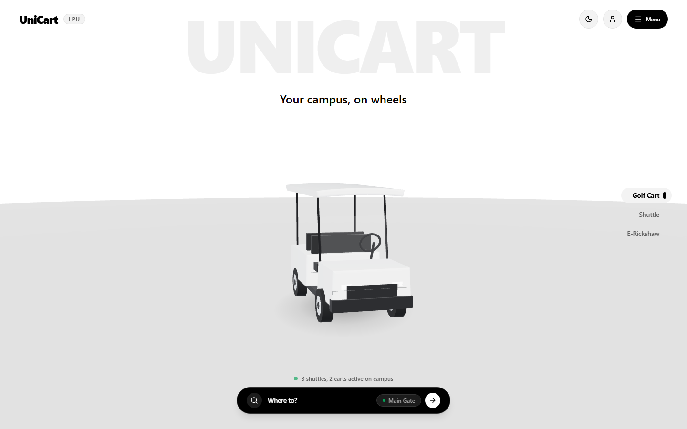
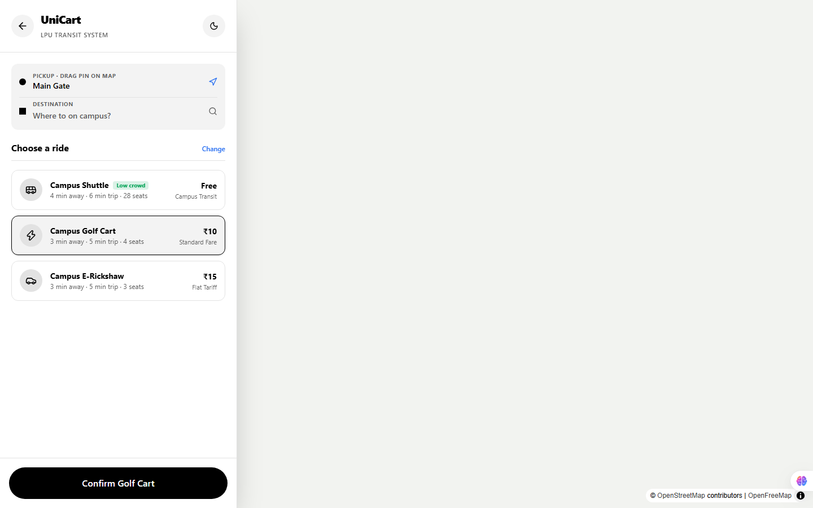
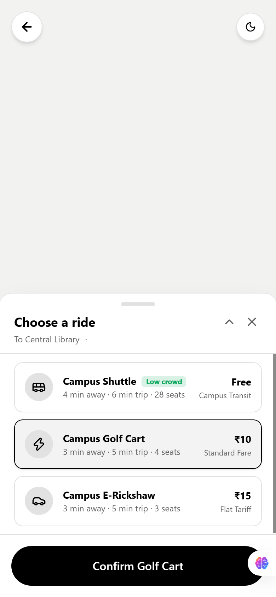
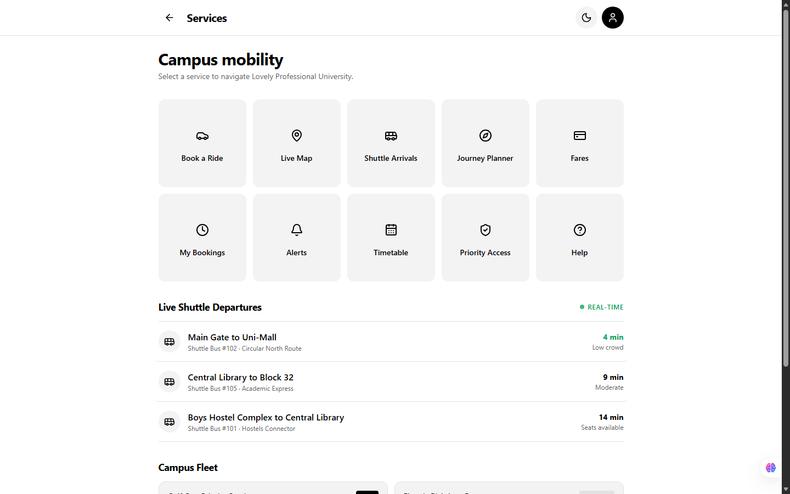
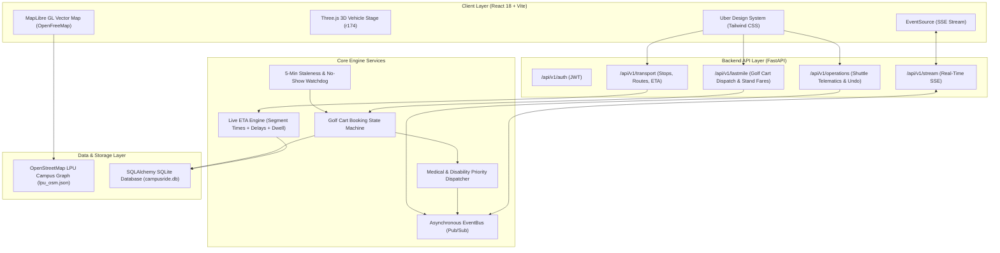

# UniCart: Your campus, on wheels

> **An Uber-inspired intelligent transit & last-mile mobility operating system for Lovely Professional University.**

[](https://github.com/ANANTYASH11/Lpu-Golfcart/actions/workflows/ci.yml)
[](LICENSE)
[](https://fastapi.tiangolo.com)
[](https://reactjs.org)
[](https://threejs.org)
[](https://maplibre.org)

---

## 📸 Visual Showcase

| 3D Hero & Vehicle Stage | Road-Snapped Booking Map |
| :---: | :---: |
|  |  |
| *Hero stage with 3D turntable, architectural wordmark & live campus stats* | *Road-snapped routing on OpenFreeMap with 3D building extrusions* |

| Mobile Ride Picker & Fleet Status | Multimodal Features Hub |
| :---: | :---: |
|  |  |
| *Priority booking sheet with live ETA, fares & crowd badges* | *Unified access to Student, Driver, Admin, and Simulation consoles* |

---

## 🎯 The Problem: P05 Waiting for the Shuttle

Lovely Professional University (LPU) is one of the largest single-campus universities in the world, spanning over 600 acres with tens of thousands of daily commuters between academic blocks, student hostels, research facilities, and entrance gates.

Students, faculty, and campus visitors consistently face the **P05 Transport Dilemma**:
1. **Unpredictable Shuttle Arrivals**: Traditional fixed timetables fail during lecture transitions and peak morning rush.
2. **Crowding Anxiety**: No visibility into whether the arriving mini-bus is empty or already at 100% capacity.
3. **Last-Mile Disconnect**: When shuttles are full or unavailable, students lack a coordinated way to book electric golf carts or check authorized e-rickshaw stand tariffs.
4. **Accessibility Barriers**: Students with medical needs, injuries, or disabilities have no priority dispatch mechanism for golf carts.

**UniCart** solves this through a real-time multimodal transit platform with live telematics, road-snapped routing, priority dispatch, and interactive 3D digital-twin vehicles.

---

## 🏛 Architecture Diagram



---

## 📦 The Three Core Modules

### 1. Student Transport Service (`/api/v1/transport`)
* **Stop & Route Intelligence**: Graph representation of verified LPU stops (Main Gate, Uni-Mall, Central Library, Block 32, Boys/Girls Hostels, etc.).
* **Dynamic Live ETA Engine**:
  $$\text{ETA} = \text{now} + \sum_{s \in \text{remaining}} \text{segment\_time}(s) + \sum_{i \in \text{intermediate}} \text{dwell\_time}(i) + \text{delay\_sec}$$
* **5-Minute Staleness Sentinel**: If a shuttle loses telematics updates for $> 300\text{ seconds}$, the system gracefully falls back to timetable schedules with a clear `"Live unavailable"` status.
* **Multimodal Journey Planner**: If a shuttle is `FULL` or `CANCELLED`, automatically re-routes students to nearby Golf Carts or E-Rickshaw stands.

### 2. Shuttle Operations Service (`/api/v1/operations`)
* **Full Trip Lifecycle**: `SCHEDULED` $\rightarrow$ `STARTED` $\rightarrow$ `AT_STOP` $\leftrightarrow$ `IN_TRANSIT` $\rightarrow$ `COMPLETED` (or `CANCELLED` / `DELAYED`).
* **Real-Time Crowd Categorization**:
  * **Low** ($< 40\%$ occupancy) — Emerald badge
  * **Moderate** ($40\% - 80\%$ occupancy) — Amber badge
  * **Full** ($> 80\%$ occupancy) — Rose alert badge
* **Atomic Driver Mis-Tap Undo**: Stack-based status history that lets drivers undo mis-tapped stops or crowd level entries with zero telemetry corruption.

### 3. Last-Mile & Golf Cart Booking Service (`/api/v1/lastmile`)
* **Formal Booking Finite State Machine (FSM)**:
  `REQUESTED` $\rightarrow$ `ACCEPTED` $\rightarrow$ `ARRIVING` $\rightarrow$ `PICKED_UP` $\rightarrow$ `COMPLETED` (or `CANCELLED` / `REJECTED` / `NO_SHOW`).
* **Medical & Mobility Priority Dispatch**: Differently-abled students and medical emergencies jump ahead in the queue or immediately preempt idle vehicles.
* **5-Minute No-Show Expiry**: Background watchdog automatically releases the assigned cart if the passenger fails to board within 5 minutes of arrival.
* **Stand Directory & Fixed Tariffs**: Transparent flat rates (₹10–₹20) across all campus stands for authorized electric autos.

---

## 🛠 Tech Stack

| Domain | Technology | Description |
|---|---|---|
| **Frontend Framework** | **React 18.3** + **Vite 6** | Ultra-responsive SPA client with fast HMR |
| **Styling & Theme** | **Tailwind CSS** | Uber-inspired monochrome token system with dark mode |
| **3D Vehicle Stage** | **Three.js (r174)** | Procedural golf cart, mini-bus, and e-rickshaw models |
| **Interactive Mapping** | **MapLibre GL v5.1** | Vector map with OpenFreeMap tiles & 3D building extrusions |
| **Animations** | **Framer Motion** | Smooth drawer transitions and bottom sheet physics |
| **Backend API** | **FastAPI** | High-performance asynchronous Python REST & SSE service |
| **ORM & Database** | **SQLAlchemy 2.0** + **SQLite** | Type-safe persistence (swappable to PostgreSQL) |
| **Testing** | **Pytest** + **Playwright/CDP** | Unit tests for FSM/ETA algorithms and visual regression tests |

---

## 📂 Project Folder Structure

```
LPU Golfcart/
├── .github/
│   └── workflows/
│       └── ci.yml               # Automated GitHub Actions test and build workflow
├── backend/
│   ├── app/
│   │   ├── models/              # SQLAlchemy models (transport, shuttle_ops, last_mile, user)
│   │   ├── routers/             # API endpoints (transport, operations, lastmile, stream, auth)
│   │   ├── schemas/             # Pydantic validation schemas
│   │   ├── services/            # ETA calculator, cart dispatcher, journey planner, SSE
│   │   ├── config.py            # Environment settings and configuration
│   │   ├── database.py          # Database engine and session factory
│   │   ├── main.py              # FastAPI app instance and startup lifespan
│   │   └── seed_data.py         # Autonomous campus seed data generator
│   ├── tests/                   # 14 comprehensive unit test suites
│   ├── simulator.py             # Live autonomous campus traffic simulator
│   ├── requirements.txt         # Python dependencies
│   └── .env.example             # Backend environment template
├── data/
│   ├── lpu_osm.json             # OpenStreetMap campus geometry and road network
│   ├── proposed_stops.json      # Verified campus stop coordinates
│   └── UNVERIFIED.md            # Stop audit and validation log
├── docs/
│   └── screenshots/             # Production application screenshots for documentation
├── frontend/
│   ├── public/                  # 3D models, GeoJSON buildings, icons
│   ├── src/
│   │   ├── components/          # 3D vehicle geometries, procedural vehicle factory
│   │   ├── context/             # Authentication & user persona context
│   │   ├── theme/               # Uber tokens and light/dark theme context
│   │   ├── utils/               # OSRM road router and coordinate snapping
│   │   ├── views/               # UberHomeView, UberBookingView, UberFeaturesView, etc.
│   │   ├── App.jsx              # Main routing and navigation controller
│   │   └── index.css            # Global typography and base styling
│   ├── package.json             # Frontend dependencies
│   └── vite.config.js           # Vite development server configuration
├── .gitignore                   # Safe Git ignore configuration
├── .env.example                 # Root environment template
├── LICENSE                      # MIT License
└── README.md                    # Project documentation
```

---

## ⚡ Quick Start & Installation

### Prerequisites
* **Python 3.10+**
* **Node.js 18+** & **npm**

### 1. Backend Setup
```bash
cd backend
python -m pip install -r requirements.txt
cp .env.example .env
python -m app.seed_data
python -m uvicorn app.main:app --host 127.0.0.1 --port 8000 --reload
```

### 2. Frontend Setup
```bash
cd frontend
npm install
npm run dev -- --host 127.0.0.1 --port 5173
```
* **UniCart Web App**: Open [http://localhost:5173](http://localhost:5173) in your browser.
* **Interactive API Docs (Swagger UI)**: Open [http://localhost:8000/docs](http://localhost:8000/docs).

---

## 🎬 Live Simulation & Demo Modes

UniCart includes an autonomous campus vehicle simulator that animates vehicles and streams real-time telemetry over Server-Sent Events (SSE):

```bash
cd backend

# Normal Continuous Autonomous Mode (Vehicles loop around campus stops)
python -u simulator.py --speed 2.0

# 8:55 AM Peak Rush Demo Mode (Simulates lecture rush & medical priority preemption)
python -u simulator.py --mode peak-rush --speed 2.0
```

### Peak Rush Demo Highlights:
1. Morning boarding surges push Shuttles past **90% capacity** (`FULL`), triggering journey planner diversions.
2. Injects an emergency medical ride from University Health Centre to Block 32, demonstrating automatic priority queue preemption!

---

## 👥 Demo Personas (One-Click Switcher)

| Persona | Role | Default Credentials | Primary Interface |
|---|---|---|---|
| **Rohit Sharma** | Student | `rohit_student` / `student123` | Booking map, timetable, ride picker |
| **Priya Patel** | Medical Priority Student | `priya_medical` / `student123` | Priority golf cart dispatch |
| **Harpreet Singh** | Shuttle Driver | `harpreet_driver` / `driver123` | Large-button driving console with Undo |
| **Gurpreet Singh** | Golf Cart Driver | `gurpreet_cart` / `driver123` | Incoming dispatch & passenger boarding |
| **Command Officer** | Campus Admin | `admin_officer` / `admin123` | Fleet telematics & peak analytics |

---

## ⚙️ Environment Variables

Copy `.env.example` to `.env`:

```env
PROJECT_NAME="CampusRide - LPU Campus Transport Management"
DATABASE_URL="sqlite:///campusride.db"
SECRET_KEY="your-secure-random-jwt-key"
ALGORITHM="HS256"
ACCESS_TOKEN_EXPIRE_MINUTES=1440
LIVE_STALENESS_THRESHOLD_SEC=300
CROWD_LOW_THRESHOLD=0.40
CROWD_MODERATE_THRESHOLD=0.80
MAX_ACTIVE_BOOKINGS_PER_STUDENT=1
NO_SHOW_TIMEOUT_SEC=300
CORS_ORIGINS="*"
```

---

## 🧪 Testing & Verification

Run the full backend test suite:
```bash
cd backend
python -m pytest tests -v
```
*(All 14 unit and integration test suites covering ETA calculations, crowd level thresholds, booking FSM transitions, and auto-dispatch priority).*

---

## 🚧 Limitations & Future Roadmap

1. **Distributed Pub/Sub**: The prototype utilizes an in-memory asynchronous event bus adhering to `EventBusInterface`. In production clusters, replace with Redis Pub/Sub or Apache Kafka.
2. **Physical Telematics Hardware**: Telemetry is currently driven by the simulation engine or driver console taps; production deployment can interface directly with vehicle OBD-II/GPS tracking devices via MQTT.
3. **Turn-by-Turn Voice Navigation**: Integrate Web Speech API for real-time auditory navigation cues on driver tablets.

---

## 📜 Credits & License

* **Map Data**: © [OpenStreetMap](https://www.openstreetmap.org/copyright) contributors.
* **Vector Basemap**: Keyless vector tiles provided by [OpenFreeMap](https://openfreemap.org).
* **License**: Released under the [MIT License](LICENSE).
